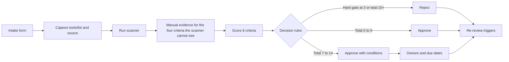

# MCP Security Review Kit

A practical framework for deciding whether an MCP server or AI connector is safe to approve: a scoring rubric, a manifest scanner, three worked reviews of real servers, and the templates around them. It maps to the OWASP Top 10 for LLM Applications, the NIST AI RMF, ISO/IEC 27001:2022 and ISO/IEC 42001.

When an AI assistant is connected to tools through the Model Context Protocol (MCP), every server becomes part of the attack surface. Most teams approve connectors by reading a README. This kit gives a security or GRC team a repeatable way to approve, condition or reject them, with evidence.

## What is in the kit

| Folder | What it holds |
|---|---|
| [`docs/`](docs/threat-landscape.md) | The 11 risks that matter at the tool layer, with real incidents and sources |
| [`rubric/`](rubric/rubric.md) | 8 scoring criteria, 4 hard gates, decision rules, and a machine-readable copy (`scoring.yaml`) |
| [`scanner/`](scanner/README.md) | A Python command line tool that reads a server's tool list and drafts scores |
| [`reviews/`](reviews/README.md) | A decision record template and three worked reviews |
| [`templates/`](templates/README.md) | Intake form, approval checklist, data flow diagram |

## How a review runs



The scanner drafts scores for four criteria (Permissions and Scope, Prompt Injection Exposure, Tool Integrity, Output Handling). It never approves anything. A human confirms every score, and the other four criteria are always manual.

## Quick start

```
pip install -r scanner/requirements.txt
python scanner/mcp_scan.py scanner/samples/poisoned.json
python scanner/mcp_scan.py reviews/fetch-server/manifest.json
```

On Windows without `python` on the path, use `py` instead. Exit code `0` means no hard gate tripped, `1` means draft reject, `2` means bad input, so the scanner can run in CI.

## Worked reviews

| # | Server | Scored profile | Total (of 24) | Verdict |
|---|---|---|---|---|
| 001 | [Filesystem server](reviews/001-filesystem-server.md) | Single project folder | 13 | Approve with conditions |
| 002 | [Fetch server](reviews/002-fetch-server.md) | Defaults, no private IPs | 11 | Approve with conditions |
| 003 | [GitHub server](reviews/003-github-server.md) | Default / hardened | 15 / 10 | Reject by default; approve with conditions when hardened |

## What the reviews found

- **Risk lives in the session, not the server.** The filesystem server and the fetch server each pass. Together they give an attacker untrusted input, private files and a way out, which the rubric scores as critical. The template now asks what else is in the session.
- **The same server can be a reject or an approval.** The GitHub server scores 15 by default and 10 with a fine-grained token, read-only mode, lockdown and logging. A single score would have hidden that, so the template records the configuration profile.
- **The scanner was wrong in useful ways.** Real servers exposed three false positives (the phrase "file system" read as a system command, search queries read as SQL, "commit" read as a write) and one miss (a benign directive in a tool description). Each is written up, and the three false-positive rules were corrected.
- **Strong controls are often built in and off by default.** Read-only mode, allow lists, lockdown, private-address blocking and command logging all exist in these servers. Review is mostly about making sure they are on.

## How the criteria map to frameworks

| Criterion | OWASP LLM Top 10 (2025) | MCP risk | NIST AI RMF | ISO/IEC 27001:2022 Annex A |
|---|---|---|---|---|
| 1 Permissions and Scope | LLM06 Excessive Agency | Scope minimisation | MAP, MANAGE | 5.15, 8.2 |
| 2 Authentication and Token Handling | LLM02, LLM03 | Token passthrough, confused deputy | GOVERN, MANAGE | 5.17, 8.5 |
| 3 Prompt Injection Exposure | LLM01 | Tool poisoning | MAP, MEASURE | 8.26, 8.12 |
| 4 Tool Integrity and Supply Chain | LLM03 | Malicious packages | GOVERN, MANAGE | 5.19 to 5.21, 8.28 |
| 5 Execution Environment | none direct | Local server compromise, SSRF | none direct | 8.20, 8.22, 8.9 |
| 6 Data Exposure | LLM02 | none direct | none direct | 5.12, 5.34, 8.12 |
| 7 Output Handling | LLM05 | none direct | none direct | 8.28, 8.26 |
| 8 Auditability and Logging | none direct | Session and token attribution | MEASURE, MANAGE | 8.15, 8.16 |

ISO/IEC 42001 controls are referenced in the rubric text. The Annex A numbering there is marked "verify" and should be checked against the published standard before use.

## Limitations

- The scanner reads only the tool list. It matches English keywords and cannot see code, authentication, hosting or logging.
- The thresholds (reject at 15, approve at 6 or less) are a first estimate. Three reviews did not argue for moving them, which is not proof they are right.
- The GitHub review used the project's test snapshots for the tool list because a live build was not possible, and says so.
- Reviews are a point in time. Servers change, so each record lists re-review triggers.

## Sources

MCP specification security best practices and authorization (2025-11-25), OWASP Top 10 for LLM Applications 2025, and the incident write-ups listed in [`docs/threat-landscape.md`](docs/threat-landscape.md).

## Licence

MIT. See [`LICENSE`](LICENSE).
