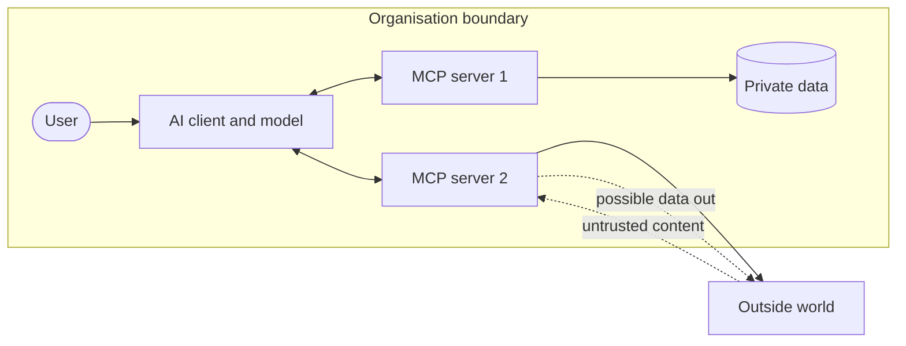
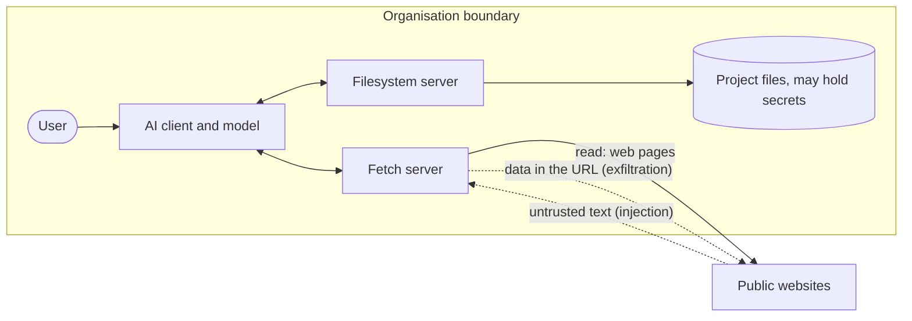

# Data Flow Diagram Template

A data flow diagram shows where untrusted content enters, where private data sits and where data can leave. Draw it before scoring Prompt Injection Exposure (criterion 3). If one path joins all three, the session is at risk even when every server looks acceptable alone.

## How to draw it

1. Put the model and AI client in the middle.
2. Add each MCP server connected to it.
3. Add the systems each server touches.
4. Mark each arrow: **read**, **write**, or **send out**.
5. Colour or label the three things that matter: untrusted input, private data, outbound route.
6. Draw the trust boundary around anything you control.

## Blank template (copy into the decision record)

## Worked example: filesystem server plus fetch server

This is the combination found in Reviews 001 and 002. Each server was approved with conditions on its own. Together they join all three things in one session, which the rubric scores as 3 for Prompt Injection Exposure.

How to read it:

- **Untrusted input:** web pages come in through the fetch server.
- **Private data:** project files sit behind the filesystem server.
- **Outbound route:** the fetch server can request any public URL, so data can leave in the query string.

Fix options, in order of strength: do not run both in one session; require human approval for every fetch; restrict fetch to an allowed list of sites; keep secrets out of the folder.
